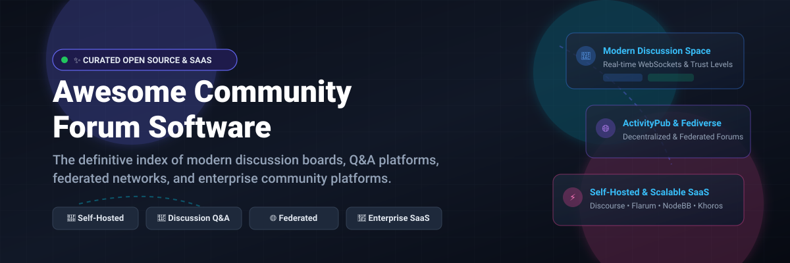
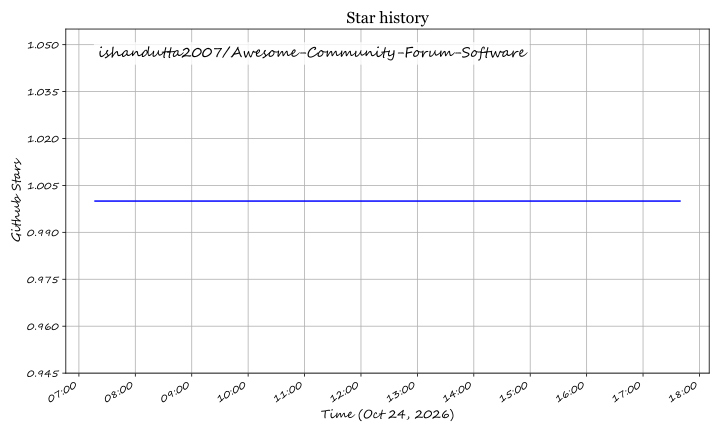

# Awesome Community Forum Software 💬🚀

  

  
  
  
  
  
  

  <strong>A curated index of top open-source community forum engines, self-hosted discussion boards, Q&A platforms, and enterprise community SaaS solutions.</strong>

---

## 🌟 Overview & Highlights 💡

Modern online communities have evolved past static bulletin boards into real-time hubs for customer support, developer relations, knowledge sharing, and decentralized social networks. Whether you need an **enterprise-ready self-hosted platform** (Discourse), an **ultralight modern board** (Flarum), a **real-time WebSocket platform** (NodeBB), a **federated ActivityPub community** (Lemmy), or a **managed creator SaaS** (Circle, Mighty Networks), this guide provides clear benchmarks for pricing, system requirements, and scalability.

- ⚡ **Self-Hosted Control**: Retain data sovereignty, GDPR/compliance ownership, and eliminate per-seat fees.
- 💬 **Versatile Topologies**: Traditional threaded boards, StackOverflow-style Q&A, and ActivityPub federation.
- 🏢 **Transparent Pricing**: Detailed starting tiers and free-trial terms across leading commercial SaaS options.

---

## 📑 Table of Contents 📌

- [📊 Sector Overview & Market Dynamics](#-sector-overview--market-dynamics-)
- [🏢 SaaS & Hosted Platforms](#-saas--hosted-platforms-)
- [💻 Open-Source GitHub Projects](#-open-source-github-projects-)
- [🤝 How to Contribute](#-how-to-contribute-)
- [⭐ Star History](#-star-history-)
- [💖 Support](#-support-)
- [⚖️ Disclaimer](#️-disclaimer-)

---

## 📊 Sector Overview & Market Dynamics 📈

The global online community and forum software market is estimated at **$1.8B – $2.4B**, growing steadily as organizations prioritize community-led growth, customer engagement, and support ticket deflection. The sector is **moderately to highly fragmented** rather than winner-take-all; top enterprise suites (such as Khoros and Higher Logic) capture less than a third of the market value, coexisting alongside specialized creator platforms (Circle, Mighty Networks), vertical-specific solutions (Hivebrite), and robust self-hosted open-source alternatives (Discourse, Flarum).

---

## 🏢 SaaS & Hosted Platforms ☁️

| Product | Description | Company Size (Rev / Valuation) | Pricing | Free Tier Limit |
| :--- | :--- | :--- | :--- | :--- |
| **[Khoros Communities](https://www.khoros.com/)** | Enterprise customer community platform for large-scale brand communities. | ~$250M – $284M ARR (Acquired by IgniteTech) | **Custom annual contract**: Starts at **$50,000/year** (standard mid-market deployments typically **$110,000–$225,000/year** based on MAU) | **No free tier and no free trial** (access via private sales demo only) |
| **[Higher Logic Vanilla](https://www.higherlogic.com/vanilla/)** | Enterprise community platform with discussion forums, Q&A, and knowledge base. | ~$65M – $70M ARR ($185M PE funding) | **Essential/Corporate**: Starts at **$24,000/year** (billed annually, custom quotes for enterprise tiers) | **No free tier and no self-serve free trial** (access via custom demo with sales) |
| **[Circle](https://circle.so/)** | All-in-one community, courses, and payments platform for creators and businesses. | ~$27.7M ARR (~$200M–$250M valuation) | **Professional**: **$89/month** (billed annually) or **$99/month** (monthly); **Business**: **$199/month**; **Scale**: **$419/month** | **14-day free trial** (full access, up to unlimited members & 20 spaces, no credit card required; no permanent free plan) |
| **[Hivebrite](https://hivebrite.com/)** | Community management platform for alumni networks, associations, and organizations. | ~$21M ARR ($100M–$250M valuation, $37M Series B) | **Core**: Starts at **$895/month** (billed annually at ~$10,740/year); **Flex**: **$1,995/month**; **Prime/Enterprise**: custom | **No free tier and no self-serve free trial** (access via 30-minute discovery call and tailored demo) |
| **[Mighty Networks](https://www.mightynetworks.com/)** | Community platform with courses, payments, and branded apps. | ~$8.6M ARR (~$100M–$250M valuation, $66M raised) | **Launch**: **$79/month** (billed annually) or **$95/month** (monthly); **Scale**: **$179/month**; **Growth**: **$354/month** | **14-day free trial** (full access to explore community spaces, events, and courses, no credit card required; no permanent free plan) |
| **[Bettermode](https://bettermode.com/)** | Modern community platform with customizable spaces and member management. | ~$3.1M ARR ($7.5M seed funding) | **Starter**: **$149/month** (billed annually) or **$199/month** (monthly); **Growth**: **$1,500/month**; **Enterprise**: custom | **14-day free trial** (full access up to 10,000 members and 5 staff seats, no credit card required; no permanent free plan) |
| **[Invision Community](https://invisioncommunity.com/)** | Full community suite with forums, galleries, blogs, and commerce. | ~$1.8M – $10M ARR (Privately held / bootstrapped) | **Creator**: **$89/month** (billed annually) or **$99/month** (monthly); **Creator Plus**: higher tiers available | **30-day free trial** (unlimited features without credit card, limited to temporary system domain, no outgoing emails, and no custom external marketplace apps) |

---

## 💻 Open-Source GitHub Projects 🛠️

*Ranked strictly in descending order by GitHub stargazers count.*

- **[Discourse](https://github.com/discourse/discourse)**   
  👑 **The enterprise self-hosted standard.** GPL-2.0 licensed. Built by Stack Overflow co-founder Jeff Atwood. **Strengths**: built-in gamification with trust levels and badges, separate chat surface, SSO via SAML/OIDC/LDAP, Akismet anti-spam, and 200+ plugins. **Resource requirements**: 2 GB RAM minimum, 4 GB recommended; Docker-based with Postgres, Redis, and Sidekiq. **Trade-offs**: Ruby on Rails can be slow without enough resources; plugin development requires Ember.js expertise. Best for established communities with 50+ daily active users needing robust moderation and enterprise SSO.

- **[Flarum](https://github.com/flarum/flarum)**   
  ⚡ **The lightweight modern alternative.** MIT licensed. PHP/Laravel-based backend with a Mithril.js frontend—fast, clean, and simple. **Resource requirements**: 512 MB RAM minimum; runs comfortably on modest VPS hardware. **Strengths**: modern single-page-app UI, extensible architecture, smallest footprint of the major open-source forums. **Trade-offs**: smaller extension catalog than Discourse, single-level threading. Best for small to medium communities wanting a clean, snappy modern forum without Discourse's infrastructure overhead.

- **[Apache Answer](https://github.com/apache/answer)**   
  💡 **Open-source Q&A community platform.** Apache-2.0 licensed. Built with Go and React for high performance and low memory consumption. **Strengths**: StackOverflow-style question-and-answer format, voting, reputation scores, badges, and multilingual support out of the box. **Resource requirements**: Lightweight Go binary running easily on 512 MB RAM. Best for developer portals, technical product support, and internal organizational knowledge bases.

- **[NodeBB](https://github.com/NodeBB/NodeBB)**   
  🔄 **The real-time forum.** GPL-3.0 licensed. Node.js-based with WebSockets for instant updates—posts appear without page refreshes, notifications pop in real-time, and the experience feels closer to a modern social application. **Strengths**: real-time updates, social-style notifications, reputation/karma, and solid REST/WebSocket APIs. **Resource requirements**: 512 MB RAM minimum; MongoDB or PostgreSQL/Redis. Best for gaming communities, tech groups, and any community where immediacy is core.

- **[Lemmy](https://github.com/LemmyNet/lemmy)**   
  🌐 **Federated ActivityPub link aggregator and forum.** AGPL-3.0 licensed. Built in Rust and Actix. **Strengths**: Decentralized and federated with Mastodon and the broader Fediverse; users on any Lemmy or ActivityPub server can subscribe to communities across instances. **Resource requirements**: Ultra-efficient Rust backend. Best for federated communities and organizations wanting privacy-focused, decentralized discussion.

- **[HumHub](https://github.com/humhub/humhub)**   
  👥 **Flexible open-source social network and intranet.** AGPL-3.0 licensed. Built on PHP and Yii framework. **Strengths**: Spaces/groups, user profiles, activity streams, directory, and a rich module marketplace for wikis, polls, and calendar events. Best for enterprise intranets, university student hubs, and organizational social networks.

- **[phpBB](https://github.com/phpbb/phpbb)**   
  🏛️ **The battle-tested classic bulletin board.** GPL-2.0 licensed. One of the longest-standing open-source forum solutions in history. **Strengths**: Unmatched stability, thousands of legacy extensions and styles, extremely low server overhead, runs on almost any shared PHP/MySQL host. Best for traditional categorized forums and hobbyist communities prioritizing longevity and simplicity.

- **[Talk (Coral Project)](https://github.com/coralproject/talk)**   
  📰 **Open-source community comment streams from Vox Media.** Apache-2.0 licensed. Built with Node.js, GraphQL, and MongoDB. **Strengths**: Tailored for journalism, publishers, and high-traffic newsrooms; advanced moderation workflows, staff badges, and toxicity filtering. Best for embedding engaging, moderated comment communities directly under articles and media publications.

- **[Talkyard](https://github.com/debiki/talkyard)**   
  🧩 **Unified community platform combining StackOverflow, Slack, and Discourse.** AGPL-3.0 licensed. Built on Scala, React, and PostgreSQL. **Strengths**: Combines open-ended forum discussions, Q&A problem solving, and nested chat streams into a single cohesive interface. Best for teams wanting discussions, team chat, and documentation in one place.

- **[Thredded](https://github.com/thredded/thredded)**   
  💎 **Embeddable Rails forum engine.** MIT licensed. Built in Ruby on Rails. **Strengths**: Drop-in forum engine designed to be mounted directly inside existing Ruby on Rails applications; supports unread tracking, bbcode/markdown, and private topics. Best for developers who already run a Rails platform and want native embedded forums without running standalone forum servers.

- **[MyBB](https://github.com/mybb/mybb)**   
  📜 **Feature-rich traditional bulletin board.** LGPL-3.0 licensed. Written in PHP. **Strengths**: Classic multi-board hierarchy, comprehensive admin panel, private messaging, reputation system, and straightforward theme templating. Best for gaming clans and niche hobby boards looking for a familiar classic forum experience.

- **[Simple Machines Forum (SMF)](https://github.com/SimpleMachines/SMF)**   
  ⚙️ **Lightweight and dependable community engine.** BSD-3-Clause licensed. Built in PHP/MySQL. **Strengths**: Renowned package manager for one-click mod installations, fine-grained permission controls, and low resource utilization. Best for hobbyist webmasters looking for rock-solid stability on budget hosting.

---

## 🤝 How to Contribute 🚀

Contributions, suggestions, and corrections are welcome! To contribute:

1. 🍴 **Fork** the repository.
2. 🌿 **Create a branch**: `git checkout -b feature/add-new-forum`.
3. ✏️ **Edit `README.md`**: follow the existing markdown table or open-source list structure (including Stars_Badge syntax).
4. 📬 **Submit a Pull Request** with a brief summary explaining the project and why it belongs here.

---

##  Star History

---

## 💖 Support 🙌

Thank you for exploring and utilizing this collection! If you find this repository valuable, here are a few ways to support its ongoing maintenance:

- ⭐ **Star this repository** to help others discover it.
- 🍴 **Fork and contribute** by adding new platforms or updating existing ones.
- 📢 **Share with your network** on Discord, X (Twitter), LinkedIn, or developer forums.
- ☕ **Sponsor or buy a coffee**: Support maintenance and development directly on the [GitHub Sponsor Dashboard](https://github.com/sponsors/ishandutta2007).

---

## ⚖️ Disclaimer 📋

- This is an independent, **community-curated index** — not an exhaustive list and not a commercial endorsement.
- **Enterprise community platforms are expensive and quote-only**: Khoros has contract values exceeding **$50,000–$160,000+/year** with no free tier or trial; Higher Logic Vanilla starts around **$24,000/year**. Self-hosted open-source alternatives eliminate recurring per-seat fees.
- **Open-source forums require server infrastructure**: Discourse recommends 2–4 GB RAM with Docker and Redis; Flarum and Apache Answer run comfortably on 512 MB VPS environments. Choose the software that aligns with your team's DevOps capabilities.

---

  Made with ❤️ for community managers, DevOps engineers, and creators building vibrant discussion spaces worldwide.

## ⭐ Star History

<a href="https://star-history.com/#ishandutta2007/Awesome-Community-Forum-Software&Timeline" align="center">
  <picture>
    <source media="(prefers-color-scheme: dark)" srcset="assets/ishandutta2007_Awesome-Community-Forum-Software_growth.svg">
    
  </picture>
</a>
